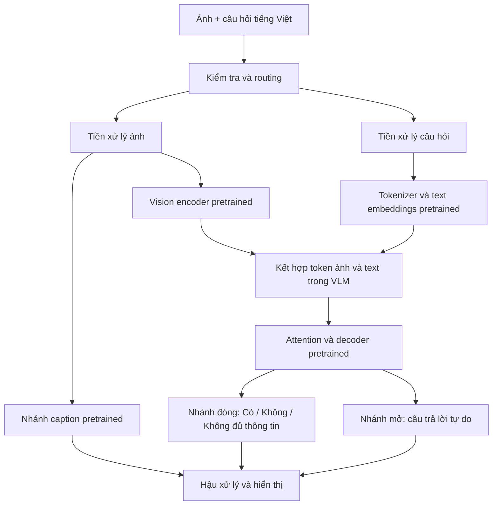

# Luồng hoạt động và ánh xạ model

Giữ nhánh caption và nhánh VQA độc lập về đầu vào logic/đầu ra. Chế độ `both` chạy cả hai tuần tự, dùng chung một checkpoint để tiết kiệm RAM. Caption không được đưa vào câu hỏi VQA, tránh thay ảnh thật bằng một mô tả có thể sai. Câu hỏi và câu trả lời mặc định bằng tiếng Việt.

| Khối ban đầu | Thay thế trong implementation |
|---|---|
| Streamlit/Gradio | Streamlit |
| BLIP caption | Lần suy luận caption riêng bằng Qwen, không dùng câu hỏi |
| DenseNet | Vision encoder có sẵn của Qwen |
| PhoBERT | Tokenizer + text embeddings của Qwen |
| Fusion/Co-Attention | Fusion/attention nội bộ checkpoint; KHÔNG phải module bidirectional Co-Attention độc lập |
| LSTM | Decoder pretrained trong Qwen |
| Closed MLP | Nhánh sinh đáp án đóng bằng prompt và chuẩn hoá chặt; KHÔNG phải MLP classifier |
| Open head | Nhánh sinh văn bản tự do |
| Output formatting | Caption + answer + metadata; confidence null |

Các khối bên trong Qwen chạy thật qua model.generate, không thêm encoder ngẫu nhiên hoặc feature giả để khớp sơ đồ. Chúng là các thành phần đồng bộ trong một checkpoint, không phải các model có thể thay độc lập mà không train. Đây là sự thay thế công cụ/model giữ chức năng và phân nhánh, KHÔNG phải triển khai nguyên topology tensor của DenseNet/PhoBERT/Co-Attention/MLP.

Trong hình pipeline, Decoding đứng trước Co-Attention, còn hình architecture đặt fusion trước heads. Implementation theo ý nghĩa hình architecture: ảnh/text được kết hợp trước và trong quá trình sinh đáp án. Không đặt fusion sau câu trả lời đã sinh.

Nhánh đóng nhận lựa chọn rõ ràng từ người dùng (`answer_type`), không dùng heuristic đoán loại câu hỏi. Nếu output không khớp chính xác Có/Không, trả Không đủ thông tin và giữ raw_answer để kiểm tra. Đây là fallback định dạng, không phải xác suất độ tin cậy. Nhánh caption/VQA có thể bất đồng vì hai lần suy luận độc lập.
